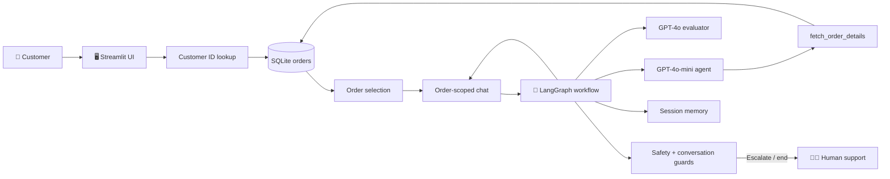
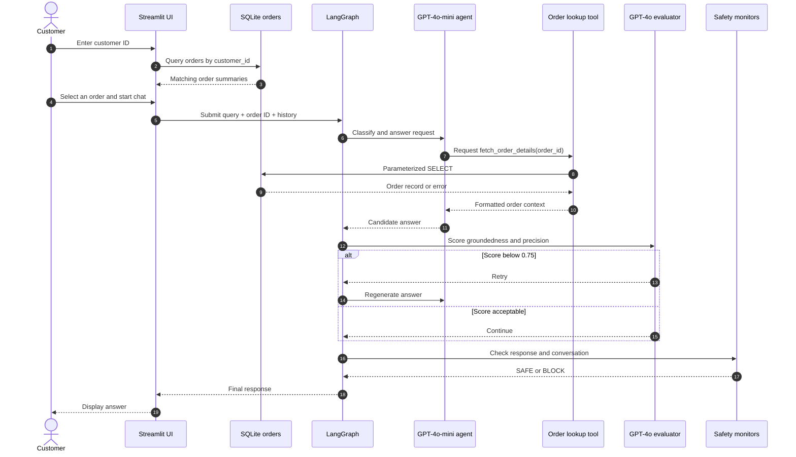
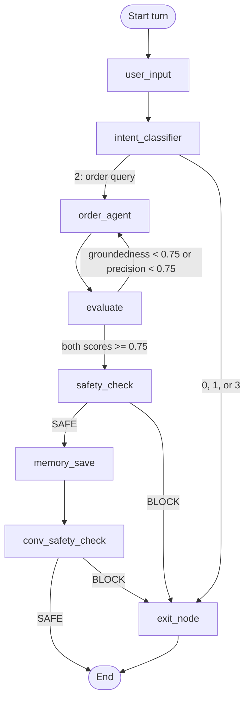
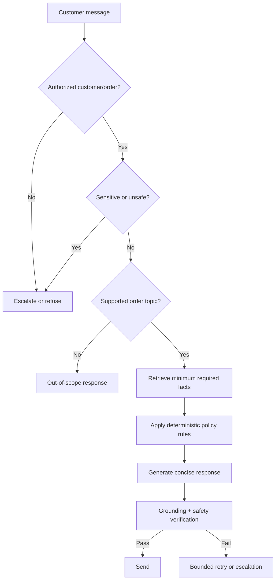

# 🛒 Kartify Customer Support Agent

## 1. Document purpose

This document explains the Kartify customer-support project represented by `Github files/app.py`. It describes the problem being solved, the current architecture, the end-to-end workflow, the data model, the agent behavior, the recommended specifications for rebuilding the system, and the main risks to address before production use.

> **Scope note:** Sections labelled **Current implementation** describe what the supplied code does today. Sections labelled **Target specification** describe a stronger version to build from scratch.

---

## 2. Executive summary

Kartify is a conversational assistant that helps a customer ask questions about one of their orders. A customer first enters a customer ID, selects an order, and then chats with an AI assistant. The assistant can retrieve order facts from SQLite and answer questions about status, delivery, tracking, payment, returns, replacements, and warranty information.

The application is deliberately more than a simple chatbot. It uses a workflow graph to:

1. Classify the incoming message.
2. Route order-related questions to an LLM agent with a database tool.
3. Evaluate the answer for groundedness and precision.
4. Retry weak answers.
5. Check the response for safety and inappropriate redirection.
6. Monitor the conversation for repeated or irrelevant advice.
7. Save the turn in session memory.

The project is important because customer-service answers must be accurate, privacy-conscious, consistent, and easy to audit. An answer that sounds helpful but invents a delivery date or return policy can create financial loss, customer frustration, and compliance risk. Kartify’s architecture therefore treats the database as the source of truth and puts validation around the language model.

### Product objective 🎯

Provide a fast, empathetic, order-aware first line of support while ensuring that the assistant:

- uses actual order data rather than guessing;
- answers only within the supported order-information scope;
- protects sensitive information;
- escalates or ends the conversation when appropriate; and
- remains understandable to customers and maintainable by developers.

---

## 3. Problem statement and motivation

### The problem

Customers often need simple answers—“Where is my order?”, “Has it been delivered?”, or “Can I return it?”—but support teams spend time looking up records and translating operational data into customer-friendly language. A generic LLM cannot safely answer these questions because it does not know the customer’s current order state and may hallucinate policies.

### Why this project matters 💡

| Need | Business impact | Kartify response |
|---|---|---|
| Faster answers | Reduces queue volume and waiting time | Conversational self-service |
| Accurate order facts | Prevents false promises and rework | Parameterized SQLite lookup |
| Consistent tone | Improves customer trust | Central system prompt and policy rules |
| Safe boundaries | Reduces privacy and unsafe-advice risk | Intent, output, and conversation guards |
| Human efficiency | Lets agents focus on exceptions | Escalation path for frustrated or unsupported requests |
| Explainable behavior | Makes failures easier to diagnose | Explicit LangGraph nodes and evaluation scores |

### Non-goals 🚫

The current project is not designed to:

- change an order, issue a refund, cancel a shipment, or modify an address;
- authenticate a customer with production-grade identity verification;
- access arbitrary customer records;
- replace human support for disputes, fraud, or sensitive account actions; or
- provide a general-purpose assistant unrelated to Kartify orders.

---

## 4. Users and primary use cases

### Primary actors

| Actor | Responsibility |
|---|---|
| Customer | Supplies a customer ID, selects an order, and asks a question |
| Support assistant | Retrieves approved facts and produces a concise reply |
| Human support specialist | Handles escalation, ambiguity, disputes, and exceptions |
| Developer/operator | Maintains prompts, workflows, data, deployment, and monitoring |

### Supported use cases

| Use case | Example customer question | Required source of truth |
|---|---|---|
| Delivery status | “Has my chair arrived?” | `actual_delivery`, `order_status` |
| Expected delivery | “When should it arrive?” | `expected_delivery` |
| Tracking | “What is my tracking number?” | `tracking_number`, `shipping_partner` |
| Payment | “Was my payment received?” | `payment_status` |
| Return policy | “Can I return this?” | `return_days_allowed`, `return_conditions`, dates |
| Replacement | “Can I get a replacement?” | `replacement_days_allowed`, `order_date`, policy |
| Warranty | “Is this still under warranty?” | `product_warranty`, delivery/order dates |
| Order status | “Is it confirmed or dispatched?” | `order_status`, `dispatch_date` |

---

## 5. Current architecture

### Component inventory

| Component | Technology in the supplied project | Responsibility |
|---|---|---|
| Web UI | Streamlit 1.42.2 | Customer ID form, order selection, chat, session reset |
| Workflow orchestration | LangGraph 0.2.55 | State, nodes, conditional routing, retries |
| Main agent model | `gpt-4o-mini` through `ChatOpenAI` | Intent classification and order-answer generation |
| Evaluation/guard model | `gpt-4o` through `ChatOpenAI` | Groundedness, precision, safety, conversation checks |
| Tool layer | LangChain `@tool` | Makes order retrieval available to the agent |
| Database | SQLite (`kartify.db`) | Stores order records |
| Data handling | pandas | Converts SQL results to formatted data and UI tables |
| Packaging | Docker + Python 3.12 | Reproducible deployment container |

### High-level architecture



For an editable architecture diagram, see [kartify-architecture.drawio.svg](kartify-architecture.drawio.svg). It is supplied as an SVG with draw.io-compatible graph metadata and can be imported into diagrams.net.

---

## 6. End-to-end workflow

### 6.1 Customer-facing journey



### 6.2 Workflow graph



### 6.3 Intent routing

| Intent ID | Meaning in code | Expected behavior |
|---:|---|---|
| `0` | Escalation | Tell the customer a human will assist |
| `1` | Exit | Close politely |
| `2` | Process | Run the order agent |
| `3` | Random/unrelated/vulnerable | Explain that the assistant only supports placed-order information |

Only intent `2` reaches the order agent. This is a useful cost and safety boundary because unsupported messages do not need a database lookup or a long model response.

---

## 7. How the order agent works

1. `run_turn()` builds an `OrderState` object containing the customer ID, selected order ID, query, previous history, and empty evaluation fields.
2. The graph sends the query to `intent_node`.
3. For a process query, `order_agent_node` calls `order_agent()`.
4. `order_agent()` binds `fetch_order_details` as an LLM tool.
5. The model may request the tool with the selected order ID.
6. The tool validates the ID against `^O\d+$`, then uses a parameterized SQL query.
7. The database result is returned to the model as tool context.
8. The model produces a concise answer following `SYSTEM_PROMPT` rules.
9. The evaluator scores the answer on groundedness and precision.
10. Weak answers go back through the order agent; acceptable answers go through safety checks.

### Data boundary 🔐

The tool returns a formatted row containing raw database fields, but the system prompt tells the model not to expose internal field names or technical reasons. The customer should receive a plain-language interpretation, such as “Your order is still on the way and is expected on 18 July,” rather than raw values such as `actual_delivery = null`.

### Current tool behavior

| Condition | Tool result |
|---|---|
| ID does not match `O` plus digits | Validation error |
| ID format is valid but missing | “No order found” message |
| SQL or database failure | Database error message |
| Matching record | Entire row formatted as text |

---

## 8. Data model and storage

### `orders` table

| Field | Type | Meaning | Customer-facing use |
|---|---|---|---|
| `order_id` | TEXT | Unique order reference | Order selection and lookup |
| `customer_id` | TEXT | Customer reference | Initial order lookup |
| `product_id` | TEXT | Product reference | Internal context |
| `product_description` | TEXT | Product name/description | UI and responses |
| `order_date` | TEXT | Order date | Return/replacement timing |
| `payment_status` | TEXT | Payment state | Payment questions |
| `order_status` | TEXT | Operational state | Status questions |
| `price_paid` | REAL | Amount paid | Payment/order context |
| `return_days_allowed` | INTEGER | Return window | Return eligibility |
| `return_conditions` | TEXT | Return conditions | Policy explanation |
| `replacement_days_allowed` | INTEGER | Replacement window | Replacement eligibility |
| `product_warranty` | INTEGER | Warranty duration | Warranty questions |
| `tracking_number` | TEXT | Shipment tracking reference | Tracking questions |
| `shipping_partner` | TEXT | Carrier | Tracking and delivery |
| `dispatch_date` | TEXT | Dispatch date | Shipment status |
| `expected_delivery` | TEXT | Promised/expected date | Delivery estimates |
| `actual_delivery` | TEXT | Actual delivery date or null | Delivered vs. in transit |

### Storage assessment

| Current choice | Benefit | Limitation | Recommended next step |
|---|---|---|---|
| SQLite file | Simple, portable, easy to demo | Weak for concurrent production writes and multi-instance deployment | Move to managed PostgreSQL for production |
| pandas SQL reads | Convenient formatting | Adds overhead and blurs data-access boundaries | Use typed repository methods or SQLAlchemy |
| Text dates such as `09-07` | Easy sample data entry | Ambiguous year and difficult date arithmetic | Store ISO-8601 dates with timezone policy |
| Full row sent to LLM | Gives the model broad context | Exposes more data than each question needs | Return a minimal, allow-listed view |

---

## 9. Target specification for a from-scratch build

### 9.1 Functional requirements

| ID | Requirement | Acceptance criterion |
|---|---|---|
| FR-01 | Customer lookup | Valid customer ID returns only that customer’s orders |
| FR-02 | Order selection | Chat cannot start until exactly one order is selected |
| FR-03 | Order-scoped answers | Every order answer is grounded in the selected order |
| FR-04 | Intent routing | Escalation, exit, and unsupported messages bypass order retrieval |
| FR-05 | Tool validation | Invalid order IDs never reach SQL |
| FR-06 | Delivery response | Missing actual delivery is described without exposing raw nulls |
| FR-07 | Policy response | Return/replacement terms are discussed only when asked |
| FR-08 | Evaluation | Every generated answer receives groundedness and precision scores |
| FR-09 | Retry control | Retries are bounded and end in safe fallback after the limit |
| FR-10 | Escalation | Blocked, unsafe, or unresolved cases provide a clear handoff |
| FR-11 | Session reset | New session clears selected order, visible chat, and memory |
| FR-12 | Auditability | Request ID, decision path, scores, latency, and errors are logged without secrets |

### 9.2 Non-functional requirements

| Category | Target specification |
|---|---|
| Availability | 99.5% monthly for an initial production release |
| Response time | p95 under 8 seconds for a normal order query; show progress while waiting |
| Accuracy | At least 95% grounded answers on a curated evaluation set |
| Safety | 100% refusal/escalation on defined sensitive-data test cases |
| Privacy | Never log API keys, raw prompts containing unnecessary personal data, or full order rows by default |
| Security | Authenticated customer context; authorization checked server-side, not only from UI state |
| Reliability | Retry model/API failures with backoff; return a deterministic fallback after exhaustion |
| Maintainability | Separate UI, workflow, repository, prompts, policy engine, and configuration |
| Observability | Structured logs, metrics, traces, evaluator outcomes, and escalation counts |
| Testability | Unit, integration, workflow, prompt-regression, safety, and load tests |

### 9.3 Suggested module structure

```text
kartify/
├── app.py                         # Streamlit composition only
├── config.py                      # Environment/config validation
├── domain/
│   ├── models.py                  # Typed order and conversation models
│   └── policies.py                # Return, delivery, escalation rules
├── data/
│   ├── repository.py              # Parameterized order queries
│   └── migrations/                # Schema and indexes
├── agent/
│   ├── prompts.py                 # Versioned prompts
│   ├── tools.py                   # Narrow, validated tools
│   ├── graph.py                   # LangGraph definition
│   └── evaluators.py              # Groundedness/precision checks
├── safety/
│   ├── input_guard.py
│   ├── output_guard.py
│   └── escalation.py
├── observability/
│   └── logging.py
└── tests/
    ├── unit/
    ├── integration/
    ├── workflow/
    └── evals/
```

### 9.4 Recommended state contract

```python
class SupportState(TypedDict):
    request_id: str
    customer_id: str
    order_id: str
    query: str
    history: list[dict[str, str]]
    intent: Literal["escalate", "exit", "order", "unsupported"]
    order_facts: dict[str, Any]
    draft_response: str
    final_response: str
    groundedness: float
    precision: float
    safety_status: Literal["safe", "blocked"]
    retry_count: int
    escalation_reason: str | None
```

The target contract uses explicit fields and enumerated values. This is safer than passing loosely formatted strings between nodes and makes routing easier to test.

---

## 10. Tool and method comparison

### 10.1 Orchestration options

| Option | Strengths | Weaknesses | Fit for Kartify |
|---|---|---|---|
| LangGraph | Explicit state machine, conditional edges, retries, inspectable workflow | More concepts and framework coupling | **Best current fit** for guarded multi-step flow |
| Plain function calls | Simple and easy to debug | Routing and retries become ad hoc as complexity grows | Good for a very small MVP |
| Server-side workflow engine | Durable execution, queues, long-running jobs | Operational overhead | Useful when support actions become asynchronous |
| Agent-only loop | Fast to prototype | Harder to constrain, test, and audit | Not recommended as the only control layer |

### 10.2 Data-access options

| Option | Best for | Trade-off |
|---|---|---|
| SQLite | Local demos, tests, single-process prototypes | Limited concurrency and operational tooling |
| PostgreSQL | Production transactional order data | Requires managed database operations |
| REST/order-service API | Existing microservice ownership boundary | Network latency and service availability dependency |
| ORM/repository layer | Typed, testable data access | Additional abstraction and schema discipline |

### 10.3 Model strategy

| Task | Current model | Target guidance |
|---|---|---|
| Intent classification | GPT-4o-mini | Consider a cheap classifier or rules for deterministic categories |
| Order response | GPT-4o-mini | Keep tool access narrow and use structured output where possible |
| Evaluation and guards | GPT-4o | Use a stronger judge initially; calibrate against human labels |
| Sensitive actions | N/A | Require deterministic policy checks and human approval; do not rely on an LLM alone |

---

## 11. Safety, privacy, and reliability design

### Threats and mitigations

| Risk | Example | Mitigation |
|---|---|---|
| Hallucination | Invented delivery date | Tool-grounded answers, evaluator, allow-listed facts |
| Cross-customer access | Guessing another order ID | Authenticate customer and enforce ownership in repository query |
| Prompt injection | Customer asks model to ignore policy | Fixed system policy, tool authorization, output validation |
| Sensitive-data disclosure | Request for OTP or bank details | Input/output guard and immediate escalation |
| Infinite retries | Evaluator never reaches threshold | `MAX_RETRIES` with deterministic fallback |
| Prompt drift | Policy changes inconsistently | Version prompts and run regression tests |
| Data leakage in logs | Full order row in trace | Redaction, field allow-list, retention limits |
| Stale data | Delivery status has changed | Transactional source or freshness metadata |
| Ambiguous dates | `09-07` interpreted incorrectly | ISO-8601 dates and explicit locale/timezone |

### Policy precedence

The target system should apply rules in this order:



---

## 12. Current implementation gaps to fix

These are observations from the supplied code, not failures of the project concept.

| Priority | Observation | Why it matters | Recommended fix |
|---|---|---|---|
| 🔴 High | Customer ownership is not rechecked inside `fetch_order_details`; the UI-selected order ID is trusted | A guessed order ID could expose another customer’s record | Query by both `customer_id` and `order_id`, with server-side authorization |
| 🔴 High | Retry routing has no explicit retry counter | A low score can loop until LangGraph’s recursion limit | Add `retry_count` and a maximum retry fallback |
| 🔴 High | The evaluator and guards are LLM-based only | A judge can be wrong or unavailable | Add deterministic checks and fail-closed behavior for sensitive cases |
| 🟠 Medium | Guard BLOCK responses route to `exit_node`, which can overwrite the guard’s handoff text based on intent | The final customer message may not match the reason for blocking | Add a dedicated `escalation_node` or preserve an explicit blocked response |
| 🟠 Medium | Conversation guard checks `state['history']`, which is the pre-turn history | It may not evaluate the newly generated turn | Pass the current query and response into the guard input |
| 🟠 Medium | Dates are stored as short text values such as `09-07` | Eligibility calculations are ambiguous | Use full ISO dates and centralize date arithmetic |
| 🟠 Medium | The tool returns the entire row | The model receives more data than necessary | Create question-specific or allow-listed fact views |
| 🟡 Low | `cust_id` is carried in state but not used by the order tool | It suggests a security boundary that is not actually enforced | Use it in repository authorization or remove the misleading assumption |
| 🟡 Low | The app depends on an implicit OpenAI API-key configuration | Misconfiguration appears only at runtime | Validate required environment variables at startup |
| 🟡 Low | SQLite path is relative to the process working directory | Deployment working directories can differ | Resolve a configured absolute data path |

---

## 13. Development plan from scratch 🧱

### Phase 1 — Domain and data foundation

1. Define supported intents and customer-facing policies.
2. Normalize the order schema and dates.
3. Add primary keys, indexes on `customer_id` and `order_id`, and ownership constraints.
4. Implement a repository with typed methods and test fixtures.

### Phase 2 — Deterministic support service

1. Build order lookup and authorization.
2. Implement delivery, tracking, payment, return, replacement, and warranty policy functions.
3. Return structured facts instead of raw database text.
4. Add unit tests for delivered, delayed, missing, ineligible, and expired cases.

### Phase 3 — Agent workflow

1. Add intent classification with a strict structured output.
2. Add a narrow order-facts tool.
3. Build the LangGraph state machine.
4. Add bounded retries, explicit escalation, and fallback responses.
5. Version prompts and record workflow decisions.

### Phase 4 — UI and operations

1. Keep Streamlit as the prototype UI or expose the service behind an API.
2. Add authenticated customer context.
3. Add structured logging, metrics, traces, and redaction.
4. Containerize and deploy with managed secrets and database configuration.

### Phase 5 — Evaluation and launch

1. Create a labelled test set of realistic customer questions.
2. Measure groundedness, precision, refusal accuracy, latency, and escalation quality.
3. Run adversarial tests for prompt injection and cross-customer access.
4. Pilot with human review before broad release.

---

## 14. Testing strategy

| Test layer | Examples | Pass condition |
|---|---|---|
| Unit | ID validation, date policy, intent mapping, redaction | Deterministic expected result |
| Repository integration | Customer/order ownership, missing record, database failure | No unauthorized or ambiguous result |
| Workflow | Each graph branch, retry, escalation, exit | Correct node and terminal state |
| Prompt regression | Delivery, return, warranty, tracking questions | No invented facts; concise answer |
| Safety | OTP, bank details, harassment, prompt injection | Block or escalate every defined case |
| Conversation | Repeated question, contradiction, frustration | Appropriate handoff or clarification |
| Performance | Concurrent order queries and model latency | Meets p95 targets |
| Deployment | Container start, secret absence, DB path | Predictable startup and error message |

### Suggested acceptance examples

| Scenario | Expected answer behavior |
|---|---|
| Delivered order | State delivered status/date from the record |
| `actual_delivery` is empty | Say it is still on the way and provide expected delivery; do not expose `null` |
| Customer asks “Can I return it?” | Mention return terms only because the customer explicitly asked |
| Unrelated question | Explain the supported order scope |
| Angry customer asks for a person | Escalate clearly and stop the normal agent path |
| Invalid order identifier | Reject before SQL and ask for a valid order reference |
| Customer ID/order mismatch | Do not disclose the record; escalate or report not found |
| Evaluator fails repeatedly | Use a safe fallback after the retry limit |

---

## 15. Deployment and configuration

### Current deployment shape

The supplied `Dockerfile` uses Python 3.12, installs `requirements.txt`, runs as a non-root `appuser`, exposes Streamlit’s port, and starts the app on `$PORT` or `8501`.

### Required configuration

| Configuration | Purpose | Handling |
|---|---|---|
| OpenAI API key | Model access | Secret manager/environment variable; never commit |
| Database path/URL | Order data source | Environment-specific configuration |
| Model names | Agent and evaluator selection | Versioned configuration, not hard-coded only |
| Retry/score thresholds | Quality and cost control | Central config with safe defaults |
| Log level and retention | Operations/privacy | Environment-specific and redacted |

### Production readiness checklist ✅

- [ ] Customer authentication and order ownership enforcement.
- [ ] Managed database or explicitly documented single-instance limitation.
- [ ] Full date format and timezone policy.
- [ ] Bounded retries and model/API timeouts.
- [ ] Deterministic sensitive-data and authorization checks.
- [ ] Secret validation and secret manager integration.
- [ ] Redacted structured logs and request IDs.
- [ ] Prompt/evaluation regression suite.
- [ ] Human escalation integration with a ticket or contact-center system.
- [ ] Monitoring for latency, failures, evaluator scores, and escalation rate.

---

## 16. Definition of done

The project is ready for a controlled pilot when a customer can select an authorized order and receive a concise, factually grounded response for every supported use case; unsupported or unsafe requests reliably stop or escalate; the system has bounded execution and observable failures; and the evaluation suite demonstrates acceptable accuracy without exposing raw internal data.

In short: **the model should translate verified order facts into helpful language—not become the source of truth itself.** 🛡️

